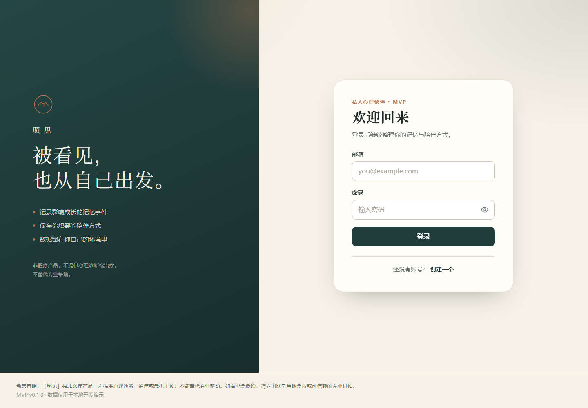
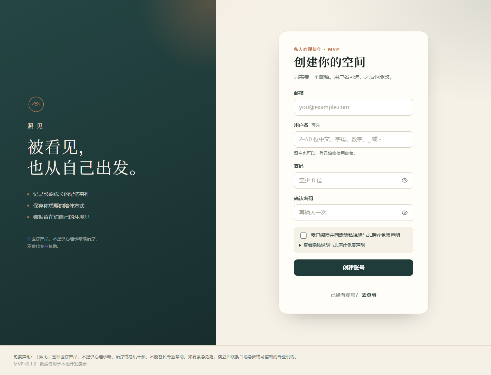

# 「照见」心理中心版 · 阶段 2A（own_partner）

> ⚠️ **免责声明**：本项目是高校心理中心的**临床文书与随访辅助工具**，不是医疗器械，不提供心理诊断、治疗决策或危机干预。系统输出仅为文书草稿，须由持证咨询师审核确认；不面向学生提供 AI 对话。如遇紧急情况，请联系校内心理中心或当地急救/心理援助热线。

## 当前进度

| 阶段 | 状态 | 交付 |
| --- | --- | --- |
| 阶段 0：新旧对照与目标模型 | ✅ | [docs/center-v2-redesign.md](docs/center-v2-redesign.md) |
| 阶段 1：角色 / 个案 / 审计 | ✅ | 迁移 `0003_center_rbac`、RBAC、`cases`、`audit_logs`、集成测试 |
| 阶段 2A：文本会谈 → 四段草稿 | ✅ 代码完成（待连库验证） | 迁移 `0005_conversations`、分段/抽取、草稿-编辑-确认 |
| 阶段 2B：语音转写 / 质量评测 | ⏳ 后续 | ASR provider、真实 LLM 冒烟、前端页面 |

旧版「私人心理伙伴」的 `events` / `event_chunks` / `agent_drafts` 及对应模型、路由、服务、测试已删除（迁移 `0004_drop_legacy`）。`providers/` 与 `memory/chunking.py` 作为通用能力保留，供阶段 3 摘要向量复用。

## 当前实现范围（阶段 1）

| 模块 | 状态 | 说明 |
| --- | --- | --- |
| 学生注册 / 登录 | ✅ | 邮箱/学号/手机号任一；Argon2id 密码哈希 + JWT |
| 角色与权限 | ✅ | student / counselor / admin / auditor；越权 404、admin 读个案 403 |
| 管理员开通咨询师 | ✅ | `POST /admin/counselors`；咨询师不开放自助注册 |
| 个案建档与归属 | ✅ | 管理员建案分配；咨询师/学生按归属查看 |
| 审计日志 | ✅ | `counselor.create` / `case.create` / `case.view`，与业务同事务 |
| CLI 首个管理员 | ✅ | `python -m app.cli create-admin` |
| 会谈录入与分段 | ✅ | 粘贴全文或手工分段；识别「咨询师/来访者」；单段上限 4000 字 |
| 事实抽取 | ✅ | 11 类事实；引文必须逐字来自原文；LLM 失败自动回退规则版 |
| 记录草稿 | ✅ | 四段结构、`[E#]` 引用、`record_versions`、修改率 |
| 记录确认 | ✅ | `draft → confirmed`；确认后不可改；审计留痕 |
| 档案摘要 / 检索 / 随访 | ⏳ 阶段 3-4 | 表与接口待建 |
| 数据导出 / 删除 | ⏳ 占位 | 返回 501 + TODO |

非目标：心理诊断、治疗决策、面向学生的 AI 对话、社区与匹配、模型训练/微调、咨询师自助注册。


## 技术栈

- **前端**：Vue 3 + Vite 7 + Pinia + TypeScript + Vue Router + axios（无 UI 组件库）
- **后端**：Python 3.12、FastAPI、Pydantic v2、SQLAlchemy 2.0（async）
- **数据库**：PostgreSQL 16 + pgvector
- **模型层**：OpenAI 兼容的 LLM / Embedding provider 抽象（默认 fake embedding，零密钥可跑）
- **部署**：Docker Compose（db + backend，redis/worker 可选）
- **迁移**：Alembic（async）

## 快速开始

### 方式 A：Docker Compose（推荐）

> Windows 下可直接双击 **start.bat**：检查 Docker、启动 db + backend、等待健康检查、启动 WSL 保活，并自动在后台启动前端（Vite 5173）且打开浏览器；加参数 `/nobrowser` 可只启动不打开页面。**check.bat** 做前后端连通性自检；**stop.bat** 会同时停止前端、容器与保活进程。

前置：Docker Desktop + Compose v2（WSL2 内安装的 Docker 也可，命令在 WSL 终端执行即可）。

> **WSL 用户注意**：Docker 装在 WSL2 内时，WSL 发行版在无活动会话约 30 秒后会自动关机，容器和端口转发随之中断，表现为 `localhost:18080` 时通时断。`start.bat` 已内置 `wsl -- sleep infinity` 保活进程来避免该问题，详见「已知限制」。

```powershell
Copy-Item .env.example .env   # 仓库已附带开发用 .env，可跳过
docker compose up -d --build
```

- 启动时 `entrypoint.sh` 自动执行 `alembic upgrade head`。
- API 文档：<http://127.0.0.1:18080/docs>（请用 `127.0.0.1`，不要用 `localhost`）
- 健康检查：<http://127.0.0.1:18080/api/v1/health/ready>（数据库不可用时返回 503）
- 端口默认避开本机常见占用：API `18080`、PostgreSQL `15432`、Redis `16379`（分别由 `BACKEND_PORT`、`POSTGRES_PORT`、`REDIS_PORT` 覆盖）。若你机器上端口空闲，也可改回 8000/5432/6379。

可选启用 Redis + ARQ worker：

```powershell
docker compose --profile async up -d redis worker
```

### 方式 B：本地开发（无 Docker）

前置：Python 3.12、PostgreSQL 16 且安装 [pgvector](https://github.com/pgvector/pgvector)。

```powershell
# 1. 准备数据库
#    CREATE DATABASE own_partner;
#    \c own_partner
#    CREATE EXTENSION IF NOT EXISTS vector;

# 2. 安装依赖
cd backend
py -3.12 -m venv .venv
.\.venv\Scripts\Activate.ps1
pip install -r requirements-dev.txt

# 3. 迁移并启动（8000 被占用时用 18080）
alembic upgrade head
uvicorn app.main:app --reload --port 18080
```

`app/core/config.py` 会依次读取 `backend/.env` 与仓库根 `.env`（容器内由 Compose 注入环境变量，不依赖文件）。所以本地在 `backend/` 下启动时无需手动导出 `DATABASE_URL`，改根 `.env` 即可。

> 只想本地跑 Python、数据库仍用 Docker 时：先 `docker compose up -d db`，根 `.env` 里的 `DATABASE_URL` 已指向 `localhost:15432`，直接迁移即可。

### 方式 C：前端开发（登录 / 注册）

前置：Node.js ≥ 20.19（Vite 7 要求）。后端需已在 `127.0.0.1:18080` 运行。

```powershell
cd frontend
npm install
npm run dev -- --host 127.0.0.1 --port 5173
```

> `start.bat` 已包含依赖检查与前端启动；本节仅用于单独调试前端。前端窗口关闭即停止 Vite。

- 打开 <http://127.0.0.1:5173/>；未登录会跳到 `/login`，注册成功自动登录并进入 `/`。
- 开发服务器把 `/api` 代理到 `http://127.0.0.1:18080`，无需改 CORS；可用 `VITE_API_BASE_URL` 覆盖请求前缀。
- 质量检查：`npm run typecheck`、`npm run build`（输出 `frontend/dist`）。

> 本机 8080 被其他项目占用，因此开发端口用 5173；生产环境的 Nginx 静态托管 + `/api` 反代仍为 TODO。

| 登录 | 注册 |
| --- | --- |
|  |  |

### 测试与静态检查

纯单元测试不依赖 PostgreSQL，可直接运行。数据库集成测试（RBAC、个案、2A 主链路）默认跳过，需要显式开启：

```powershell
cd backend

# 默认：单元测试，约 40 项，无需数据库
.\.venv\Scripts\python.exe -m pytest

# 集成测试：会重建 TEST_DATABASE_URL 指向库的 public schema，勿指向开发库
$env:RUN_DB_TESTS="1"
.\.venv\Scripts\python.exe -m pytest -m integration

.\.venv\Scripts\python.exe -m ruff check app alembic tests
```

### 端到端冒烟（Docker）

```bash
# Git Bash / WSL 终端，项目根目录；Windows 也可用 wsl 调用
bash scripts/smoke_center.sh          # 阶段 1：重建镜像 + 中心版链路
bash scripts/smoke_center.sh --no-up  # 复用已运行的栈
```

`smoke_center.sh` 覆盖：CLI 创建管理员 → 开通两名咨询师 → 学生注册 → 建案分配 → 管理员读个案 403 / 接案咨询师 200 / 他咨询师 404 / 学生本人 200 → 审计动作齐全。成功输出 `✅ SMOKE PASS`。

> 已在 WSL2 的 Docker 上跑通（记录见 `docs/todo.md`）。


## 目录结构

```text
own_partner/
├── .env / .env.example        # 开发环境变量（.env 已被忽略）
├── docker-compose.yml         # db + backend（redis/worker 在 async profile）
├── docs/
│   ├── architecture.md
│   ├── api.md
│   ├── center-v2-redesign.md   # 阶段 0+1：新旧对照与目标模型
│   └── todo.md
├── backend/
│   ├── Dockerfile
│   ├── entrypoint.sh          # alembic upgrade head && uvicorn
│   ├── alembic.ini
│   ├── alembic/
│   │   ├── env.py
│   │   └── versions/
│   │       ├── 0001_initial.py        # 历史：初始 users / events / ...
│   │       ├── 0002_persona_todo.py   # 历史：空占位迁移
│   │       ├── 0003_center_rbac.py    # 角色 + cases + audit_logs
│   │       └── 0004_drop_legacy.py    # 删除 events / event_chunks / agent_drafts
│   ├── app/
│   │   ├── main.py            # 应用工厂、CORS、异常处理
│   │   ├── cli.py             # create-admin 管理命令
│   │   ├── core/              # 配置、安全、异常、角色、审计
│   │   ├── db/                # base / mixins / session / models
│   │   ├── schemas/           # Pydantic 请求响应模型
│   │   ├── api/
│   │   │   ├── deps.py        # 当前用户、角色依赖、CaseViewer
│   │   │   ├── router.py      # /api/v1 汇总
│   │   │   └── routes/        # auth / admin / cases / health / privacy
│   │   ├── services/          # 业务编排（auth / admin / cases / audit）
│   │   ├── providers/         # EmbeddingProvider / LLMProvider 抽象与实现
│   │   ├── memory/            # chunking（通用切片）；阶段 3 补检索/摘要
│   │   └── workers/           # ARQ 配置与任务存根
│   └── tests/
├── frontend/                  # Vue 3 + Vite + Pinia + TS（登录 / 注册已实现）
│   ├── vite.config.ts         # /api 代理到 127.0.0.1:18080
│   ├── src/
│   │   ├── api/               # axios 客户端与 auth 接口
│   │   ├── stores/auth.ts     # Pinia 会话状态
│   │   ├── router/            # 路由与登录守卫
│   │   ├── views/             # Login / Register / Home / NotFound
│   │   ├── components/        # AuthLayout / PasswordInput / Footer
│   │   └── utils/             # 校验、错误映射、localStorage
│   └── src/styles/main.css
└── scripts/
    └── smoke_center.sh        # 中心版阶段 1 冒烟（RBAC/个案/审计）
```

## 环境变量

| 变量 | 默认 | 说明 |
| --- | --- | --- |
| `DATABASE_URL` | 见 `.env.example` | asyncpg DSN |
| `SECRET_KEY` | 开发占位值 | JWT 签名密钥；**生产必须更换**，否则启动失败 |
| `ACCESS_TOKEN_EXPIRE_MINUTES` | `1440` | Token 有效期（分钟） |
| `CORS_ORIGINS` | `http://localhost:5173,http://localhost:8080` | 逗号分隔白名单 |
| `EMBEDDING_PROVIDER` | `fake` | `fake` 或 `openai_compat` |
| `EMBEDDING_DIM` | `1536` | 阶段 3 档案摘要向量维度（固定） |
| `CHUNK_SIZE` / `CHUNK_OVERLAP` | `400` / `50` | 字符级切片参数 |
| `LLM_*` | 空 | 本期仅抽象，不调用 |
| `REDIS_URL` | `redis://localhost:16379/0` | 可选异步任务（async profile） |
| `POSTGRES_PORT` | `15432` | 宿主机映射的 PostgreSQL 端口 |
| `BACKEND_PORT` | `18080` | 宿主机映射的 API 端口 |
| `REDIS_PORT` | `16379` | 宿主机映射的 Redis 端口 |
| `VITE_API_BASE_URL` | `/api/v1` | 前端请求前缀；开发期走 Vite 代理 |

Embedding provider 使用 OpenAI 兼容服务时：

```dotenv
EMBEDDING_PROVIDER=openai_compat
EMBEDDING_BASE_URL=https://api.openai.com/v1
EMBEDDING_API_KEY=sk-...
EMBEDDING_MODEL=text-embedding-3-small
```

## 创建首个管理员

管理员不能自助注册，首个管理员用 CLI 创建（在 `backend/` 下，确保能连到数据库）：

```powershell
cd backend
.\.venv\Scripts\python.exe -m app.cli create-admin --email admin@example.com --password "ChangeMe123" --name 管理员
```

重复执行会提示「邮箱已存在」并以退出码 1 结束。之后用管理员登录，即可开通咨询师与创建个案。

## API 一览

完整说明见 [docs/api.md](docs/api.md)。

| 方法 | 路径 | 说明 |
| --- | --- | --- |
| POST | `/api/v1/auth/register` | 学生注册（201）；email / student_no / phone 至少一个 |
| POST | `/api/v1/auth/login` | `identifier` + 密码，返回 JWT |
| GET | `/api/v1/auth/me` | 当前用户（含 role） |
| POST | `/api/v1/auth/logout` | 登出（204；无状态 JWT 由客户端清理令牌） |
| POST / GET | `/api/v1/admin/counselors` | 开通咨询师 / 咨询师列表（admin） |
| GET | `/api/v1/admin/audit-logs` | 审计日志（admin / auditor） |
| POST | `/api/v1/cases` | 创建个案并分配咨询师（admin） |
| GET | `/api/v1/cases`、`/cases/{id}` | 本人个案列表 / 详情（counselor / student） |
| GET | `/api/v1/health/live`、`/ready` | 存活 / 就绪 |


## 安全与隐私（本期最低要求）

- 密码使用 **Argon2id** 哈希，绝不明文存储。
- JWT HS256，`sub` 为用户 UUID，**载荷不含角色**：每次请求查库，角色变更/停用即时生效。
- 角色仅四类：`student / counselor / admin / auditor`，DB CHECK 约束 + 服务层校验。
- 归属校验在 API 层强制：咨询师只能读本人接案、学生只能读本人个案；越权统一 404；admin 读取个案内容返回 403。
- 审计日志只追加、不提供修改/删除接口；`counselor.create`、`case.create`、`case.view` 与业务同事务落库。
- 管理员接口不返回个案内容；审计 `metadata` 不写自由文本。
- 数据仅存本地开发数据库；导出/删除账号接口返回 501，仅保留接口契约。
- 注册页必须勾选隐私与免责声明；登录 / 注册页与全局 footer 均展示免责声明。
- 开发期只使用模拟或脱敏数据；真实个案数据不得离开校内环境。

## 已知限制

- 阶段 1 只到「账号 / 个案 / 审计」；咨询记录、摘要、简报、随访、账号停用与密码重置均未实现。
- 审计目前是应用层 append-only，拥有数据库权限的人仍可改；生产需 DB 权限或触发器兜底。
- 前端尚未重做：现有页面仍是旧版登录 / 注册，中心版工作台、个案与记录页面待阶段 2。
- 阶段 2-4 的咨询记录、摘要、检索、随访尚未实现；worker 仅有 `ping` 存根。
- 没有 ANN 索引；阶段 3 建向量表后再按数据量加 HNSW/IVFFlat（见 [docs/todo.md](docs/todo.md)）。
- 阶段 3 建向量列时需与 `EMBEDDING_DIM=1536` 对齐；换 embedding 模型需新增迁移并重算。
- 8080 被本机其他项目占用，前端开发端口使用 5173；生产 Nginx 静态托管与 `/api` 反代仍为 TODO。
- **WSL2 内 Docker 的空闲关机**：WSL 发行版在无活动会话时约 30 秒后自动 `poweroff`，容器与 Windows 端口转发随之中断（表现：`localhost:18080` 前几次可用、随后连接被拒或超时）。`start.bat` 用 `wsl -- sleep infinity` 保活，`stop.bat` 会清理；若绕过脚本直接 `docker compose up`，需自行保持 WSL 存活。另外 Windows 侧请用 `127.0.0.1` 而非 `localhost`（`localhost` 可能优先解析 IPv6，而 WSL 转发只监听 IPv4）。
